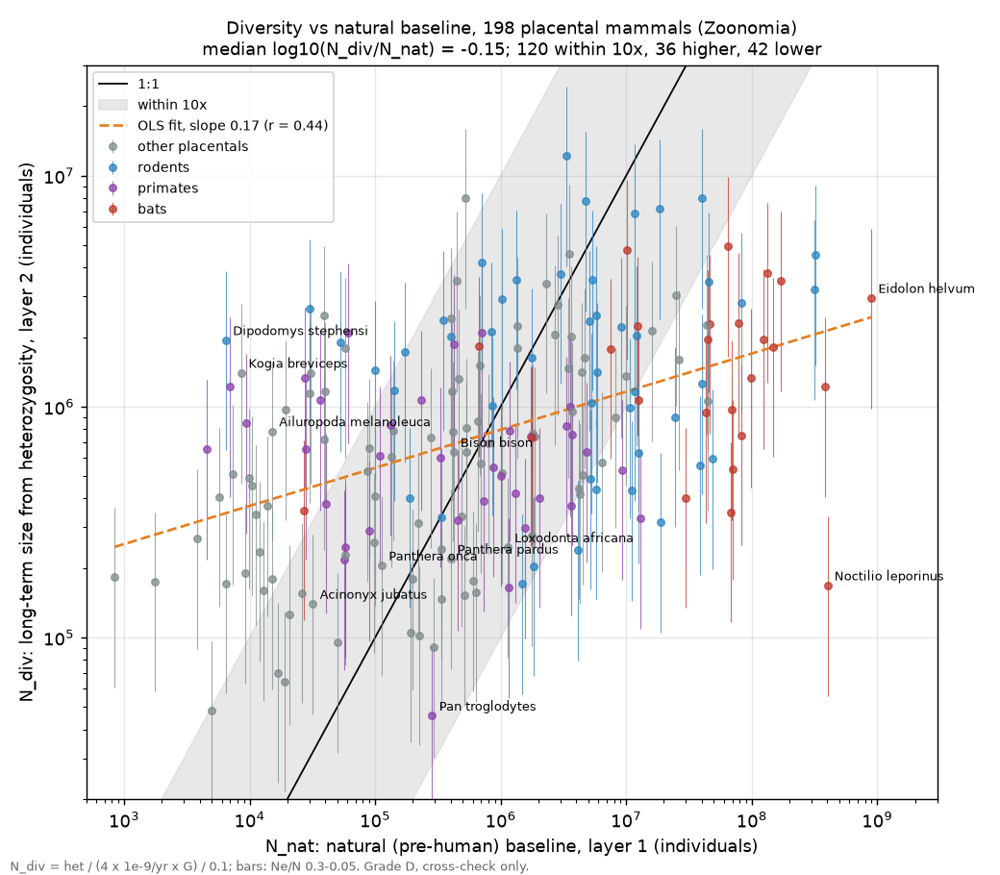

# Genetic diversity as a check on the natural baseline (layer 2, ToLaD#63)

Layer 2 of the estimate stack asks one question: does a species' genetic diversity give a long-run
population size that agrees with layer 1, the natural (pre-human) baseline `N_nat` (ToLaD#61)? It is a
**cross-check only**. Nothing here feeds the counts, the curves or the tiles. The build writes it to
`data/mammals/stats.json` → `diversity_crosscheck` (code: `pipeline/tolad_pipeline/diversity.py`).

## Method

- **Data:** Zoonomia, Wilder et al. 2023, *Science* 380:eabn5856, Table S1 (CC BY 4.0, pinned in
  `pipeline/SOURCES.md`). It gives the genome-wide heterozygosity of one individual per species: the
  length-weighted mean of heterozygous sites per callable base over 50-kb windows of the assembly.
- **Long-term Ne:** `Ne = het / (4 μ_gen)`, with `μ_gen = μ_year × G`.
  - `μ_year` per site per year, per lineage since ToLaD#74 (see "Per-lineage μ" below): a fit of the
    pedigree rates of Bergeron et al. 2023 (*Nature* 615:285) on generation time, with per-order
    offsets. The analysis below was made with the earlier flat `μ_year = 1.0e-9`, a mammal default
    taken from Pantherinae pedigree rates (Armstrong et al. 2025, *GBE* 17:evaf060).
  - `G` is the pipeline's generation length (COMBINE / Pacifici et al. 2013). It matches Zoonomia's own
    generation times: median difference 0.0 dex.
- **Head count:** `N_div = Ne / 0.1` (Frankham 1995). The range runs from Ne/N = 0.3 (lo) to 0.05 (hi).
  Grade D.
- **Shared constants:** layers 2 and 3 (the genomic deep past) use the same μ and Ne/N.
- **What it measures:** heterozygosity averages over the coalescent depth, about 4 Ne generations (on
  the order of 10⁵–10⁶ years). So `N_div` is a long-run, harmonic-mean-like size. It is not a level at
  any date.

## Coverage

- **209** species have a heterozygosity value; **204** of them map to a tree leaf.
  - Subspecies samples fall back to their species.
  - The dog and the goat share a leaf with the wolf and the wild goat, and the first row wins.
  - *Camelus dromedarius*, *Murina feae* and *Nannospalax galili* do not map to any extant leaf.
- **198** of those leaves have a natural baseline, and **200** have a wild count today.
- **Samples:** 100 wild, 80 captive, 12 domestic, 12 unrecorded.

## Agreement

| log10(N_div / other) | n | median | p5 / p25 / p75 / p95 | within 10× | N_div > 10× higher | N_div > 10× lower |
|---|---|---|---|---|---|---|
| vs natural baseline | 198 | −0.15 | −1.87 / −0.88 / +0.75 / +1.84 | 120 | 36 | 42 |
| vs today's count | 200 | −0.04 | −1.87 / −0.88 / +0.92 / +2.21 | 112 | 47 | 41 |

- **In the middle, the two layers agree.** The medians are almost 1:1. For 111 of the 198 species,
  `N_div` falls inside the natural baseline's own 95% range.
- **The slope is far below 1.** Regressing log `N_div` on log `N_nat` gives a slope of **0.17**
  (r = 0.44).
  - `N_nat` spans 6.0 orders of magnitude, while `N_div` spans only 2.4.
  - So the gap between the layers depends on how abundant a species is:

  | N_nat | < 10⁴ | 10⁴–10⁵ | 10⁵–10⁶ | 10⁶–10⁷ | 10⁷–10⁸ | > 10⁸ |
  |---|---|---|---|---|---|---|
  | species | 14 | 35 | 51 | 54 | 35 | 9 |
  | median dex | +1.90 | +1.26 | +0.26 | −0.53 | −1.36 | −1.91 |

- **By group:**
  - Bats: median −1.66; 19 of 25 are more than 10× lower.
  - Rodents: median −0.41; 16 lower, 4 higher.
  - Primates: median −0.15.
  - Other placentals: median +0.26; 24 higher, 5 lower.
- **Where they disagree by more than 10×:** 78 species (listed in full in `disagree_natural_10x`).
  - *N_div low:* abundant bats and rodents. *Noctilio leporinus* is −3.4 dex, *Rousettus*, *Eidolon*
    and *Myotis brandtii* about −2.3 to −2.5, and *Peromyscus maniculatus* −2.0.
  - *N_div high:* rare or narrow-range species. *Dipodomys stephensi* is +2.5, *Beatragus hunteri*
    +2.3, *Indri* +2.2, *Kogia breviceps* +2.2, giant panda +1.7 and *Eubalaena japonica* +2.0.

## What it says about the natural baseline's error

1. **Most of the disagreement is structural, not error in `N_nat`.** This compressed slope is
   Lewontin's paradox: diversity across species barely tracks census size. Three things cause it:
   - Ne/N falls as N rises.
   - Linked selection trims diversity in large populations.
   - Diversity remembers the deep (Pleistocene) past.

   A 10× gap at either end of the abundance scale is therefore expected even if `N_nat` were exact.
   Layer 2 cannot confirm or refute the baseline for very abundant species (bats, small rodents) or
   very rare ones.
2. **Where the two scales overlap (`N_nat` ≈ 10⁵–10⁷, 105 species),** the median gap is −0.5 to +0.3
   dex. That is no sign of a systematic error in layer 1 larger than about 3×. The baseline's stated
   95% range covers `N_div` for 56% of all species, so the stated D-grade width is about right, not
   too narrow.
3. **The high-side outliers say "large in the deep past", not "large before people".** Giant panda,
   indri, *Eubalaena japonica* and the Sumatran rhino (+1.1 dex) all have diversity left from much
   larger Pleistocene populations. Layer 3 (genome Ne curves) is the right tool for that history, not a
   correction to `N_nat`.
4. **Known weaknesses of this layer:**
   - It rests on one individual per species, 40% of them captive.
   - Some values sit far from the population literature. For example, chimpanzee 0.00037 against
     whole-population values near 1e-3.
   - μ was a single Panthera-based default, not carried in the lo/hi range. Fixed in ToLaD#74 (below):
     short-lived small mammals do have higher per-year rates, and that pushes their `N_div` lower still.
   - Using outbred heterozygosity instead would shift `N_div` by a median of −0.12 dex.

**Verdict:** keep `N_div` as a reported cross-check. Do not use it as a prior on `N_nat`. Its slope
of 0.17 would drag every abundant species down and every rare one up by orders of magnitude, so any
blend would mostly import Lewontin's paradox rather than information.

## Per-lineage μ (ToLaD#74)

Since ToLaD#74, `μ_year` is the lineage's rate (`pipeline/tolad_pipeline/mutation.py`; the model and its
per-order table are in `pipeline/history/README.md`, "Deep past"): `log10 μ_year = −8.30 − 0.77 log10 G`
plus an order offset (Rodentia +0.11, Perissodactyla −0.15, the rest ~0), from the 32 pedigree mammals of
Bergeron et al. 2023. Its 95% prediction band (×/÷ 1.74) is now carried in `lo`/`hi`, with the Ne/N range.
Over the 204 Zoonomia species the rate is 0.35×–5.0× the old flat 1e-9 (median 1.24×), so `N_div` moves
by the inverse. `stats.json → diversity_crosscheck.mu_effect` reports both versions:

| | flat 1e-9 | per lineage |
|---|---|---|
| slope of log `N_div` on log `N_nat` (r) | 0.165 (0.44) | 0.067 (0.24) |
| slope on log today's count (r) | 0.150 (0.44) | 0.053 (0.21) |
| `N_div` span, dex | 2.42 | 1.88 |
| vs natural: within 10× / > 10× higher / > 10× lower | 120 / 37 / 41 | 109 / 38 / 51 |
| vs today: within 10× / higher / lower | 111 / 48 / 41 | 101 / 48 / 51 |
| median dex vs natural | −0.13 | −0.17 |

The correction makes the paradox **stronger**, not weaker: abundant species are mostly small and
short-lived, so their faster per-year rate lowers their `N_div` further, while long-lived rare ones
(great apes, whales, rhinos) get a slower rate and a higher `N_div`. The slope against the natural
baseline drops from 0.17 to 0.07, and ten more species fall more than 10× below it. The verdict stands,
more firmly: `N_div` is a cross-check, never a prior on `N_nat`. (The per-group medians and the
abundance-bin table above are from the flat-rate run.)
