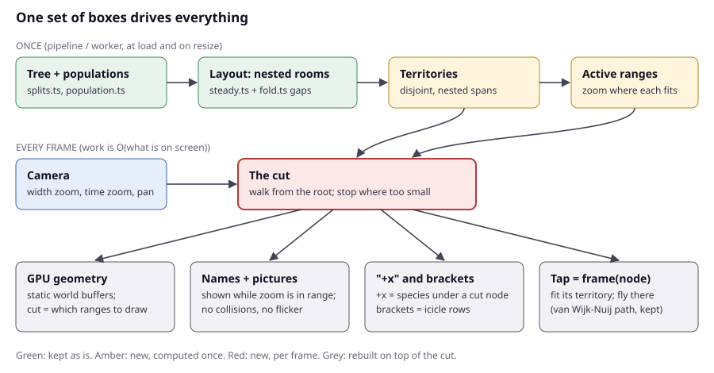

# A solid, scalable zoomable tree: how the field does it, and what ToLaD should build (ToLaD#330)

## Summary

**The problem is not the layout. It is that names, pictures, "+x", brackets and framing are decided again on every frame by a greedy search over every candidate, with tuned constants.** The steady column layout (#259) is already the textbook answer for nested populations: fixed, nested rooms, the same idea as a Muller plot. The flight path is already van Wijk and Nuij's. Everything that grew by patching is the part the field solves differently.

**What the field does instead:**

1. **Label by a cut through the hierarchy, not by collision search.** OneZoom walks the tree from the root and stops at the first node small enough on screen. That node gets the picture and name (a "signpost"), and nothing under it is labelled.
2. **Decide once, in advance, the zoom range in which each label shows.** This is the "active range" from dynamic map labelling (Been et al. 2006 and 2010). Once the ranges exist, a frame only asks "is the zoom inside this label's range?". Labels cannot flicker, and what you see does not depend on how you got there.
3. **Draw static geometry on the GPU, with the camera passed in as a uniform.** Per frame, only choose which ranges of the buffers to draw.

**Recommendation.** Keep the data, the steady layout, the camera and the flight path. Replace label placement, "+x", brackets and framing with **one set of boxes**: each node's *territory*, meaning its room plus its share of the gaps beside it, which never overlaps another node's. From the territories, compute each label's active range once, at load and on resize. Then each frame walks a single **cut** of the tree, and that cut decides at the same time:
- what is drawn merged,
- what is named and pictured,
- what each "+x" counts,
- what a tap frames.

Move the columns to static GPU buffers.

**The plan.** Each step goes behind a toggle on Pages first.

1. Territories and active ranges as a pure module, with tests. Nothing visible changes.
2. Names, pictures, "+x" and brackets drawn from the cut (`?labels=cut`). **You compare old and new side by side.**
3. Framing from the same boxes (`?frame=cut`). **Every tap frames its group with all names on screen.**
4. Columns from static GPU buffers (`?gl=cols`). **Mammals pinch at 60 fps.**
5. The cut decides merged clades on the GPU as well, which retires the per-row LOD work.
6. Mammal data as a binary file decoded in a worker. **Mammals open in about 2–3 s instead of ~12 s.**
7. A scale test with a synthetic tree of 10⁵–10⁶ leaves, plus subtree tiles and anchor-relative coordinates if it needs them.
8. Delete the old path and the toggles once you pick.
9. Only then, highlight tuning (hominins, cats), done as priority weights rather than pixel nudges.

**Honest risks:**
- Names will appear later while zooming than today's greedy pills do, because a label may no longer spill over a neighbour's space. Step 2b adds the optimal 1D "borrow unused room" pass (Been et al. 2010) if that reads too sparse.
- Fossil names sit at different heights, so the territory rule is conservative for them.
- Float32 precision on the GPU limits width zoom to about 10⁶ before anchor-relative coordinates are needed (step 7).

---

## 1. Prior systems

| System | Layout | LOD | Labels and pictures | Rendering and data | What carries to ToLaD |
|---|---|---|---|---|---|
| **OneZoom** ([Rosindell & Harmon 2012](https://doi.org/10.1371/journal.pbio.1001406); [source](https://github.com/OneZoom/OZtree)) | Fractal. Each child is placed in its parent's unit frame (`nextx/nexty/nextr`), precomputed (research/03 §1.1). | Recursion stops below an on-screen size threshold, which adapts to frame time. A node that is "massively wide" while zoomed out is drawn as a fake leaf standing for its descendants (`force_fake`, [shape_manager.js](https://github.com/OneZoom/OZtree/blob/main/OZprivate/rawJS/OZTreeModule/src/projection/shape_manager.js)). | **No collision search.** A leaf's detail depends only on its own on-screen radius: `r > 20` gives a thumbnail and one name, `r > 50` a name and thumbnail, `r > 90` full text ([leaf_layout_base.js](https://github.com/OneZoom/OZtree/blob/main/OZprivate/rawJS/OZTreeModule/src/projection/layout/leaf_layout_base.js) L25–28). **Signposts** are found by a top-down walk. The first node with `rvar <= sign_thres` whose box is wide enough for text gets a picture and name, and `under_signpost` suppresses every label under it (`get_visible_and_signpost_nodes`, shape_manager.js L136–165). | Canvas 2D; visible nodes collected into a pool sized 1,300 (`ArrayPool(1300)`). Anchor re-basing keeps the numbers screen-sized. The topology ships whole and metadata is fetched per visible node. | The **cut**: labels come from the hierarchy plus on-screen size, and each label sits inside its own geometry, so labels cannot collide. Anchor-relative numerics. |
| **Lifemap** ([de Vienne 2016](https://doi.org/10.1371/journal.pbio.2001624)) | Half-circles sized by species count, coordinates computed once in a pipeline and stored in PostGIS. | Raster map tiles per zoom, rendered on request and cached. | The pipeline precomputes "half-circle centers where clade names are written at some zoom levels", and each node's zoom level goes into the search index. | Mapnik tiles on Leaflet. 52 zoom levels to the deepest species (research/03 §1.2). | **Label zoom levels are data, decided offline.** The client only looks them up. |
| **Mapbox / MapLibre GL** ([collision wiki](https://github.com/mapbox/mapbox-gl-native/wiki/Collision-Detection); [collision_index.ts](https://app.unpkg.com/maplibre-gl@6.9.0/files/src/symbol/collision_index.ts)) | Vector tiles per zoom. | Tile pyramid. | Labels are tried "in order of their importance" against a screen `GridIndex` of 30 px cells. Placement aims to fit a 60 fps loop and accepts "a couple hundred milliseconds" of latency. Changes fade, and a `CrossTileSymbolIndex` keeps a label's identity and fade across zoom levels so it does not pop. | GPU, with workers that build tile buckets. | When greedy placement is needed, it runs **throttled**, not per frame, and fades hide its changes. ToLaD already copies some of this (carry, fades). The lesson is that maps need it only because their labels are 2D and unordered. Ours lie on a 1D row (see §3). |
| **iTOL** ([Letunic & Bork 2021](https://doi.org/10.1093/nar/gkab301)) | Classic rectangular and circular tidy layouts. | — | Static labels per leaf, with no zoom-dependent selection. | SVG/Canvas, server-side export. | Little: it is an annotation tool, not a deep zoom. |
| **Evogeneao, Tree of Life Web** ([evogeneao archive](https://web-archive.nli.org.il/National_Library/20160526010038mp_/http://evogeneao.com)) | Hand-drawn time-scaled poster, or linked pages. | — | Hand-placed. | Static. | Only the visual idea that diversity through time can be shown as width. Nothing algorithmic. |
| **TimeTree** ([timetree.org](https://timetree.org/)) | Time-scaled trees. | — | — | Server-rendered. | — |

**Takeaway.** The two systems that scale to millions of leaves (OneZoom, Lifemap) **never run a global label-collision search per frame.** Label visibility is a function of a node's own size on screen (OneZoom), or a zoom level computed offline (Lifemap). Mapbox's greedy grid placement is the fallback for unordered 2D labels, and even Mapbox throttles it and hides its changes with fades.

## 2. Population-through-time layouts (Muller plots, streamgraphs)

- **Muller plots and fishplots nest each child inside its parent's band.** [fishplot's `layoutClones`](https://github.com/chrisamiller/fishplot/blob/master/R/layout.R) ([Miller et al. 2016](https://doi.org/10.1186/s12864-016-3195-z)) works top-down at each time point. It puts a parent's children inside the parent's band and splits the parent's leftover "inner space" equally into n+1 gaps. [ggmuller](https://cran.r-project.org/web/packages/ggmuller/vignettes/ggmuller.html) and [EvoFreq](https://doi.org/10.1186/s12859-019-3173-y) also draw a descendant emerging from within its parent's polygon, with thickness equal to population or frequency.
- **Recomputing positions at every time slice makes everything move.** These layouts are recomputed per time slice, so when one population changes, every band beside it moves. That is exactly the "wave" the old `fold.ts` packing showed at mammal scale.
- **Streamgraphs try to reduce that motion by choosing the baseline and the layer order.** [Byron & Wattenberg 2008](https://doi.org/10.1109/TVCG.2008.166) set the baseline to minimise *wiggle*, the total slope change of layer edges, and order layers by onset time. [Dobler & Nöllenburg 2025](https://arxiv.org/abs/2506.21175) prove that several wiggle-minimisation variants are NP-hard and hard to approximate, and give an exact MILP.
- **ToLaD's steady layout (`steady.ts`, #259) is the zero-wiggle limit.** Each species has a fixed room, its widest ever. Clades are their daughters' rooms side by side, and a column moves sideways only at its own splits. This is a *nested fixed-allocation* layout: a Muller plot whose bands are sized by peak rather than by current value. It trades empty space for exact stability, and it is the right choice for a zoomable view, because a layout that moves under the camera defeats every downstream cache.
- **Keep it.** The only remaining degree of freedom is the left/right order of daughters, which sets the peel lengths. Choose it by a cheap heuristic, onset order as in Byron & Wattenberg. Optimising it is NP-hard and buys little when centres are already constant.
- **Rooms and gaps give each node its territory.** The rooms are disjoint and nested by construction, and the gaps between them open with zoom (`fold.ts` `openness`). That is all §3 needs: each node gets a **territory**, an x-interval from the middle of the gap on its left to the middle of the gap on its right. Territories are disjoint, nested (a clade's territory is the union of its leaves'), and **monotone in the width zoom**: on screen they only grow as you zoom in. `foldedFrame` (brackets.ts L758) already depends on that monotonicity ("the span (px) a zoom gives grows with it").

## 3. Label and picture placement

- **The theory: zoom consistency.** [Been, Daiches & Yap 2006](https://doi.org/10.1109/TVCG.2006.136) define consistency for zoomable maps:
  - labels do not pop in and out while zooming one way;
  - a label does not jump;
  - what shows depends only on the current view, not on the path taken there.

  Each label gets one **active range** of scales, and choosing the ranges is done **in advance**. At runtime, showing a label is a range test. [Been, Nöllenburg, Poon & Wolff 2010](https://doi.org/10.1016/j.comgeo.2009.03.006) show that the 2D version is NP-complete, while **the simple 1D version is solved optimally by dynamic programming.** Recent work extends this to [temporal and rotating maps](https://arxiv.org/abs/1609.06327).
- **Why ToLaD is the easy case.** ToLaD's names and pictures stand on one row ("now"), or at a fossil's tip. Their x is world-fixed and monotone in zoom, and only the **width** zoom moves them apart. Time zoom and panning never change which labels conflict. That is the 1D case.
- **The rule: a label shows exactly when it fits inside its own territory.**
  1. **Fit.** A node's name or picture is *eligible* at width zoom z when its territory on screen is at least the pill or picture width. Territories are disjoint, so **two eligible labels can never overlap, by construction.** There is no collision test, no grid, no sort and no hysteresis. Monotonicity gives one threshold z_fit(node), found by bisection exactly as `foldedFrame` does.
  2. **Cut.** At zoom z the labelled set is the OneZoom signpost cut: walking from the root, a node is labelled when it is eligible and not all of its children are. Its eligible children label themselves, and the rest are summed into its **"+x"**.

  So "+x" is no longer counted by a second pass over pills (`plusGroups`) and repeated layouts until the room holds (lab255c). It is the number of species under a cut node that have no label of their own, and since z_fit is fixed, that number can be precomputed per node as a step function of z. Each label then has one active range, [z_fit(node), z_fit at which all its children fit). That is Been et al.'s model with consistency for free, including the "same labels whatever the way there" test that lab255c had to fight for.
- **Brackets are icicle-plot rows.** The bracket stack is an **icicle plot** ([Kruskal & Landwehr 1983](https://doi.org/10.1080/00031305.1983.10482733)): one row per rank, each clade spanning its territory. A bracket shows its name when its territory fits the text, then its Latin name, then a tick, by the same z_fit test. No row packing per zoom bucket is needed.
- **Priority is degree of interest.** Where a choice remains (step 2b below, or which picture represents a clade), use a **degree-of-interest** score: a priori interest (familiar name, people, cats) minus distance from the focus, after [Furnas 1986](https://doi.org/10.1145/22339.22342) and [Card & Nation 2002](https://doi.org/10.1145/1556262.1556300). Highlights become *weights in this one score*, not pixel nudges.
- **The cost:** a label may not spill into a neighbour's unused territory, so names appear later than with today's greedy pills.
- **The fix, if it reads too sparse:** run Been et al.'s optimal 1D active-range DP, in priority order, over neighbours in leaf order. It lets a label borrow the room of neighbours that are not labelled at that zoom. It is still computed once, at load and on resize, never per frame.
- **Fossils.** Fossil names at their tips use the same x-only test. That is exact (rooms are disjoint in x, so labels never overlap) but conservative: two fossils far apart in time yet close in x wait longer than needed.
- **Screen width matters.** `openness` depends on screen width, so ranges are computed in the worker at load and on resize (O(n log n)), not in the pipeline.

## 4. Camera and framing

- **Keep the camera and the flight path.** Semantic zoom, where what is drawn depends on scale and not only on size, goes back to [Pad (Perlin & Fox 1993)](https://doi.org/10.1145/166117.166125). ToLaD's anisotropic camera (`camera.ts`) and its flights are sound. `flightPath` already implements [van Wijk & Nuij 2003](https://doi.org/10.1109/INFVIS.2003.1249004) (ρ = 1.2; d3 uses √2 by default, [d3-interpolate zoom](https://d3js.org/d3-interpolate/zoom)).
- **Framing should come from the same boxes.** SpaceTree ([Plaisant, Grosjean & Bederson 2002](https://doi.org/10.1109/INFVIS.2002.1173148)) frames the subtree being opened by its bounding box. TreeJuxtaposer ([Munzner et al. 2003](https://doi.org/10.1145/882262.882291)) guarantees that marked regions stay visible. In both, the frame is the content's own box.
- **ToLaD's framing today is several functions plus padding constants.** It is `levelCamera`, `groupCamera`, `cladeCamera`, `foldedFrame`, `withBand`, `FIT_DWARF`, and `PILL_ROOM_PX` "room each side" (#319).
- **The replacement: frame(node) = its territory in x × [its split, now] in y,** at the zoom where that territory fills the screen, solved by the existing bisection.
  - Every label of the node and its children is centred inside a territory inside the frame, so **nothing is cut off at the edge without any padding constant.**
  - Whether the children's names show at that frame is the same z_fit test, so a frame and its labels can never disagree.
  - "+x" taps frame the cut node's territory.

## 5. Speed at scale

**Where the time goes today** (#255 reports):
- Columns are Canvas 2D paths rebuilt on the CPU (`twigs.ts` `ColumnPath`). Gpu255e had to add a per-frame *build budget* because about 3,000 paths were rebuilt on one frame (5.5–6.6 s).
- Labels lay out about 480 lines of `labelSpots` per layout. `resolveLabels` tests each spot against every shown box (`taken.some`, O(n²)), and "+x" repeats the layout up to 3 times.
- The lanes are GL rects in screen space, re-uploaded each frame (`uView` is the only transform uniform).
- Mammals open by fetching and parsing `mammals.json`.

**What gives 60 fps at 10⁴–10⁶ leaves:**
- **Static world-space buffers, camera as a uniform.** Build each column's outline once, in a worker, in world coordinates (x relative to its room's centre; y in log-time knots). A frame then only changes uniforms: sx, sy, the pan, the log-time map.
  - The only zoom-dependent geometry is the gap opening. Pass it as a **per-node x-offset texture**, a prefix sum over about 14k gaps in leaf order, which is O(nodes) and under 1 ms per frame, or only when the width zoom changes.
  - The vertex shader adds the offset for the node's id. A peel blends its parent's and its own offset by the same ease it uses now.
  - Instancing and world-space buffers are the standard approach in [deck.gl](https://deck.gl/docs/developer-guide/coordinate-systems) and MapLibre (research/03 §2).
- **LOD as range draws.** In leaf order, a clade is a contiguous index range. The cut that picks labels also picks what is drawn: a merged clade's precomputed aggregate ribbon (today's `lod.ts` rule, `MERGE_PX`), or its species' range. A frame is then a few draw calls with no per-row work.
- **Anchor-relative coordinates beyond about 10⁶ zoom.** Float32 holds about 7 digits. Width zoom spans about 10¹², so subtract an anchor (OneZoom's re-anchoring, or deck.gl's offset coordinate systems) before upload. Mammals at species level may not need it. A 10⁶-leaf tree will.
- **Compact binary data in a worker.**
  - Columnar typed arrays: populations as knots, the tree as parent indices, the seed layout. Ship them as one binary file, brotli on Pages.
  - Decode and compute territories and active ranges in a worker, then hand the ArrayBuffers over as transferables.
  - Past about 10⁵ leaves, ship subtree tiles. `web/src/data/tile-source.ts` and `worker.ts` from the first engine already do this.
- **Text stays 2D canvas while it is bounded.** With the cut, a frame draws at most about 100–200 labels and pictures. Canvas 2D handles that in about 1–2 ms. SDF text in GL (the old `engine/labels.ts`) is only needed if the budget grows.
- **The frame budget then works out.** Uniform updates take about 0.1 ms. The cut walk is O(visible nodes). Draw calls are a handful. Labels are O(shown). Every per-frame term is bounded by what is on screen, not by the number of species. That is the property OneZoom and the map stacks rely on.

## 6. Mapping onto the code: keep / replace / build

| Area | Today | Verdict | Why |
|---|---|---|---|
| Data | `splits.ts`, `population.ts`, pipeline dated tree | **Keep** | Correct and data-driven. No hand tables. |
| Layout | `steady.ts` rooms; `fold.ts` gaps by age opening with zoom | **Keep.** Add territories (new, small). | Already the zero-wiggle nested layout (§2). Audit `layout.ts` `placeRiver`/`Packer` and the old fold packing for code only the cats/carnivores still reach. |
| LOD | `lod.ts` merged clades (`MERGE_PX`, `CLOSED_PX`) | **Generalise** into the one cut | Same idea as OneZoom's `force_fake`. It should be the same walk that picks labels. |
| Names, pictures, "+x" | `labelSpots` (~480 lines), `resolveLabels` (greedy, hysteresis), `plusGroups`, `familyPills`, `carryLabels`, `NameMode`, ~38 numeric constants in `view.ts` | **Replace** with territories, active ranges and the cut | §3. This is where most of the 124 commits touching `view.ts` since 11 Oct went. |
| Brackets | `brackets.ts` row packing per zoom bucket | **Replace** with icicle rows from territories | Same fit test. Keep the naming (English/Latin by rank). |
| Camera | `camera.ts` (anisotropic, limits, `settle`), `flightPath` (van Wijk–Nuij) | **Keep** | Sound, and cited. |
| Framing | `levelCamera`, `groupCamera`, `cladeCamera`, `withBand`, `FIT_DWARF`, `PILL_ROOM_PX` | **Replace** with `frame(node)` from the territory; keep the `foldedFrame` bisection | §4 |
| Columns | Canvas 2D `ColumnPath` plus the build budget `pathFrame` | **Replace** with static GL buffers | §5 |
| Lanes and individuals mesh | `meshgl.ts` | **Keep**, and move to world space with the column buffers | Already GPU. |
| Twigs (deep zoom) | `twigs.ts` strands | **Keep** for now | Only a few species are on screen at that depth. |
| Loading | `mammals.json` plus a seed | **Replace** with a binary file and a worker. Reuse `data/worker.ts` and `tile-source.ts` for tiles. | §5 |

## 7. Build plan (worker-sized steps)

Each step lands behind a toggle on Pages, so Ita can compare and pick by looking. The old path stays the default until he does.

| # | Step | Replaces | Verified by | Ita sees |
|---|---|---|---|---|
| 1 | `territory.ts`: territories per node at width zoom z; `z_fit` per node for name, picture and bracket text (bisection); the cut walk; "+x" as a step function. Pure, with tests. | — | Property tests at all three levels: territories disjoint and nested, monotone in z; at random cameras no two shown labels overlap and every shown label is inside its territory; the shown set is identical whatever gesture reached the camera. | Nothing. |
| 2 | Draw names, pictures, "+x" and brackets from the cut (`?labels=cut`). | `labelSpots`, `resolveLabels`, `plusGroups`, `familyPills`, carry, hysteresis, bracket row packing | `frames.test` and `carry.test` style checks against the new path; label time per frame ≤ 2 ms at mammals (drawperf). | Old and new labels side by side on Pages. |
| 2b | If 2 reads too sparse: Been et al. optimal 1D active ranges with DOI priority (borrowing unused neighbouring room). | — | Same tests, plus more labels shown at home. | Denser names, still no flicker. |
| 3 | `frame(node)` from the territory (`?frame=cut`). | `levelCamera` padding, `groupCamera`, `FIT_DWARF`, `PILL_ROOM_PX` | `frames.test`: every level, group and "+x" lands with its node's and children's labels on screen. | Taps frame groups cleanly. |
| 4 | Columns as static world-space GL buffers, plus the gap-offset texture (`?gl=cols`). | `ColumnPath`, `pathFrame` budget, Canvas column fills | glcheck pixel agreement with the Canvas path; `phoneperf` p95 ≤ 16 ms on pinch, pan and flight at mammals. | Smooth mammals. |
| 5 | The cut drives merged clades on the GPU (range draws). | `lod.ts` per-row greens | Pixel agreement; draw calls per frame ≤ ~20. | Same look, faster. |
| 6 | Binary mammal file plus worker decode; territories and ranges built in the worker. | `mammals.json` parse on the main thread | loadperf; open ≤ 3 s on the phone proxy. | Mammals open fast. |
| 7 | Scale test: a synthetic procgen tree of 10⁵–10⁶ leaves through the same path; add anchor-relative coordinates and subtree tiles if it needs them. | — | phoneperf at 10⁵ and 10⁶. | A "big tree" toggle. |
| 8 | Delete the old path and the toggles Ita did not pick. | `view.ts` shrinks by an estimated 1.5–2k lines | Whole suite. | — |
| 9 | Highlights: DOI weights for hominins, cats and familiar names. | per-clade nudges | Tests that the weights only reorder priorities. | Tuned highlights. |

Steps 1–3 and 4–5 are independent and can run in parallel. Step 6 needs only step 1.

## 8. Risks

- **Sparser names.** Strict territories show fewer names at home than greedy pills, because tiny-population species have narrow rooms. Mitigations: the gap shares in the territory, "+x", and step 2b.
- **The "beside" name modes become a cut-level choice.** `NameMode` beside, mid and gap was a way to make pills fit. Under territories, where a name sits *within* its territory is a free choice, but a name *beside* a narrow column only shows if the territory holds it.
- **Monotonicity has to be guarded by a test.** If a future layout change lets a territory shrink while zooming in (for example, gaps that close), active ranges stop being single intervals. The step 1 test must guard this.
- **Fossils at different heights.** The x-only test is conservative for them: correct, but some fossil names appear later.
- **The GPU rewrite of the columns (step 4) is the largest step.** The peel S-curves and the per-species green/gray lanes must match the current pixels. glcheck is the guard.
- **What this research did not check.** It did not profile, and it did not measure the real share of frame time each step removes. The numbers in §5 come from the #255 reports.

## Sources

The citations are inline; DOIs were checked against Crossref on 2026-10-14. OneZoom code was read from `github.com/OneZoom/OZtree` main (`shape_manager.js`, `leaf_layout_base.js`, `signpost_layout_base.js`). fishplot code was read from `github.com/chrisamiller/fishplot` (`R/layout.R`). ToLaD code is from `origin/main` 2254c1e.
