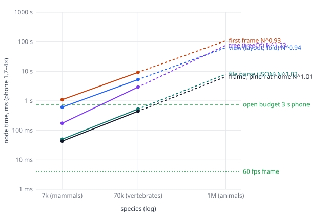

# The scale yardstick: a synthetic 70k and 1M species tree, and what opening and moving it costs (ToLaD#343)

Ita asked (2026-10-14): "are we doing things right this time around? like would it scale? coz the next level is quite a bunch more animals".

**Short answer: no, not yet.** The mammals (7k species) are the largest tree the current code can open:
- **70k (all vertebrates):** it opens, but in about 18 s of node time, so more than a minute on a phone. Every frame costs about 0.45–0.8 s in node, so a pinch on a phone shows a new picture every 2–3 s. It needs 6 GB of memory.
- **1M (all animals):** it never opens. Its data file would be about 1.15 GB of JSON, and V8 cannot hold a string longer than 512 MB, so the file cannot even be parsed. Its memory would be tens of GB.

Almost every step grows **linearly with the number of species, per frame as well as at load.** At 60 fps the cost of a frame has to depend on what is on screen, not on the size of the tree, so the frame cost is what has to change.

## The yardstick

`web/src/fan/synthetic.ts` generates a tree of any size, with the same data shape as `mammals.json`: a dated tree, living and fossil species, population histories, mass, generation length, Red List, natural baselines and names. It is deterministic for a given seed and size. Each rule is a standard model, with its parameters read off `data/mammals`:

| | rule | 7k synthetic | mammals |
|---|---|---|---|
| topology, dates | birth–death reconstructed tree as a coalescent point process (Lambert & Stadler 2013), μ/λ 0.8, root 195 Ma | split ages q25/50/75 1.5 / 4.3 / 10.9 Ma | 1.4 / 3.4 / 7.5 Ma |
| splits, polytomies | splits < 0.1 Myr apart merged | 6,856 splits, 198 polytomies | 6,273, 348 |
| fossils | 51 per 7,015 living, grafted on random edges | 51 | 51 |
| mass | Brownian motion of log mass down the tree | log10 g q5–q95 −0.3…2.9 | 0.8…4.6 |
| population | Damuth's law plus log-normal scatter | alive log10 median 6.0 | 5.9 |
| histories | 10.6% of the living, curated-style segments | 742 | 746 |
| names | temporal banding: order < 66 Ma, family < 33 Ma, genus < 18 Ma | 1,176 named splits | 689 |
| JSON | the same `MammalData` shape | 8.1 MB | 9.4 MB |

The synthetic tree is more balanced than a real one (depth 27 vs 40), because a coalescent point process gives a Yule-shaped topology.

**Sanity check: the 7k tree times like the mammals.** These are node times for the same steps (`loadperf` with the seed):

| | tree | view | first frame | the build's seed |
|---|---|---|---|---|
| mammals | 178 ms | 747 ms | 781 ms | 2,775 ms |
| synthetic 7k | 174 ms | 611 ms | 1,095 ms | 2,906 ms |

### How to run it
All of this runs on demand only, by hand, for speed work. None of it is in the suite. The suite carries only `synthetic.test.ts`, a 600-species check that takes well under a second.

- **Everything:** `cd web && npm run build:single && flock /tmp/tolad-browser.lock node scripts/scale.mjs`
  - It runs node, then the phone proxy, at 7k and 70k, with the default labels and with `?labels=cut&frame=cut`.
  - It writes `scale-out/*.json` and prints the fitted exponents.
- **Options:** `NS=`, `MODES=default,cut,noorders`, `NODE=0`, `PHONE=0`.
- **Node only, one size:** `SCALEPERF=out.json SCALE_N=70000 npx vitest run src/fan/scaleperf.test.ts`
  - `SCALE_GESTURES=0` measures the load only.
  - `SCALE_PROF=f.cpuprofile` records a CPU profile.
- **In the page:** `?level=synthetic&n=70000`. It is off the level stepper.
  - `&labels=cut&frame=cut` turns on the cut labels and framing.
  - `&orders=0`, `&seed=0` and `&json=0` are the switches below.
  - The page stamps `tl:synth-gen`, `tl:synth-seed` and `tl:synth-file` for the build's part. From `tl:fetch` on, the stamps are the mammals' own.

**How long a run takes on this machine:**

| run | time | peak memory |
|---|---|---|
| node, 7k | ~1 min | ~1 GB |
| node, 70k, load only | ~1 min | — |
| node, 70k, with gestures | ~40–60 min | 6.1 GB |
| phone proxy, 7k | ~1 min a load, ~2 min with gestures | — |

At 70k the gestures run slowly because each frame takes most of a second, and a flight in and back is about 300 frames. The 1M tree is not run: it does not fit, as explained below.

## What the tree has to be told: its orders
The first finding came before any timing. **A tree is drawn with level of detail only if its orders are in a hand list.**
- The fold's level above the orders and the merged clades (`lod.ts`) both work from `splits.ts` `ORDER_TAXA`, the 25 mammal order names.
- The 7k synthetic tree has no orders in that list. With nothing merged, it opened with a 12 s first frame and frames of about 0.6 s, against 1.1 s and 0.04 s once its orders were registered.
- The same is true of any real vertebrate or animal tree today: none of its orders are in the list.

The synthetic level registers its own orders (the splits founded under 66 Ma) so that it measures the mammals' design at scale. `?orders=0` measures it without them. The fix is in the plan already: the cut walk of `research/scalable-tree.md` §5, step 5, has to choose what is merged from the tree's own structure, not from a list of names.

## The numbers (node; the phone proxy is 1.7–4× slower, see below)

The exponent b is the fit of t ∝ N^b between 7k and 70k.

| step | 7k | 70k | b | 1M (extrapolated) |
|---|---|---|---|---|
| **build** (vite.config.ts today): generate | 92 ms | 436 ms | 0.7 | — |
| **build**: the layout seed | 2.9 s | 31 s | 1.03 | ~8 min |
| file size (JSON) | 8.1 MB | 81 MB | 1.00 | **~1.15 GB: over V8's 512 MB string limit, cannot be parsed** |
| parse (`r.json()`) | 50 ms | 526 ms | 1.02 | (cannot) |
| tree (`treeOf` + `nameOrders`) | 174 ms | 2.9 s | **1.22** | ~75 s |
| clade (`cladeOf`) | 22 ms | 186 ms | 0.93 | ~2.5 s |
| view (`new FanView`: layout, fold) | 611 ms | 5.3 s | 0.93 | ~65 s |
| first frame | 1.1 s | 9.2 s | 0.93 | ~110 s |
| **open, parse to first frame** | **2.0 s** | **18.1 s** | 0.97 | **~4–5 min** |
| frame, pinch and pan at home | 43 ms | 440 ms | 1.0 | ~6 s |
| frame, pinch and pan in the largest order | ~40 ms | ~500 ms | 1.1 | ~10 s |
| frame, pinch and pan in its largest family | ~46 ms | ~770 ms | 1.2 | ~20 s |
| flight in and back, per frame | 35–42 ms p50 | ~0.7 s | ~1.2 | — |
| memory (node rss) | 1.0 GB | 6.1 GB | 0.8 | **~50 GB** |

How the 70k frame times were read: they are the gesture's wall time divided by its 70 frames, from the run's log. The 70k run's per-frame JSON was not finished when this was written, so the p50/p95 figures are only for 7k. At 7k:
- home: pinch p50/p95 49/156 ms, pan 12/70, flight 42/90;
- the largest order: pinch 40/72, pan 34/58;
- its family: pinch 42/109, pan 50/83.

`?labels=cut&frame=cut` at 7k costs about the same: home pinch p50 48, pan 12, flight 36. Its first frame is 1.6 s against 1.1 s.

**Phone proxy at 7k** (4× throttle). The machine was busy with the 70k node run (6 GB) and other sessions, at load average 8–14, so the two loads below differ by 3× for the same steps. Read the quieter one. The steps are timed by the page's stamps from `tl:fetch`, with the build's generation and seed before it left out:

| step | busy run (default labels) | quieter run (`?labels=cut&frame=cut`) |
|---|---|---|
| parse | 0.3 s | 0.08 s |
| tree | 0.5 s | 0.12 s |
| clade | 2.3 s | 0.55 s |
| gl + layout | 3.5 s | 0.8 s |
| fold | 1.4 s | 0.43 s |
| view | 1.4 s | 0.28 s |
| first frame | 3.6 s | 1.06 s |
| **parse to first frame** | **12.9 s** | **3.3 s** |
| labels frame | +19.8 s | +6.0 s |
| HTML + script before it | 3.0 s | 1.0 s |

The phone frame deltas from these runs (rAF p50 of 0.2–2.6 s) are mostly contention, so they are not quoted. The draw's own time is steadier. Its p50 is 185–415 ms on the phone proxy against 40–50 ms in node, the expected ~4×. So a 7k frame is already about 12× over a phone's 16.7 ms, and the 70k frame about 110×.

The phone 70k run was not made: it needs about 6 GB, and the worker's memory lease is 2 GB.

### Which steps break first, and where
1. **The data file, at about 400k species.** JSON grows exactly linearly (1.15 KB per species, 38% of it histories). It crosses V8's 512 MB string limit (`MAX_STRING_LENGTH` 536,870,888) at about 450k species. Past that, `r.json()` cannot run at all, which is why 1M never opens. Long before that, 81 MB at 70k is too much to fetch on a phone.
2. **Memory, between 70k and 1M.** At 70k it is about 87 KB per species. The species records, genealogies, the Steady layout's typed arrays and the twig caches all scale with N. A phone tab has roughly 0.5–1 GB, which today is reached at about 10k species.
3. **Every frame is O(N).** The node profile at 7k, over 60 s of gestures, puts the time here:
   - Steady's per-row layout: `row`, `left`, `extent`, `centreSums`, `compute`, `follow` (~27 s).
   - The strands of species not merged: `drawStrand`, `lanePoints`, twigs (~21 s).
   - The merged clades' greens: `drawMerged`, `Lod.greenAt` (~15 s).
   - `xRange`/`xTable` (~10 s).
   - Labels (~8 s).

   Each of these walks every node or every species on each frame. That is the opposite of the property in `scalable-tree.md` §5: "every per-frame term bounded by what is on screen".
4. **`treeOf` is superlinear** (b ≈ 1.2): it is the only load step that grows faster than N. Everything else at load is linear, but at about 0.26 ms of node time per species (about 1 ms on a phone), which alone puts 70k over a minute.

## Budgets: opening 70k in ≤ 3 s and pinching at 60 fps on the phone proxy
How much slower the phone proxy is than node was measured here at 7k: about 1.7× for the load steps (3.3 s against 2.0 s in the quieter run) and about 4× for the draw. The budgets use 4×, the conservative figure. So 3 s on the phone is about 750 ms in node, and a 16.7 ms frame is about 4 ms in node.

| step | budget on the phone | node | today at 70k (node) | factor to cut |
|---|---|---|---|---|
| HTML + script | 0.8 s | 200 ms | ~250 ms (the mammals') | 1 |
| fetch the first tile | 0.4 s | — | 81 MB JSON | the bytes ÷ 40 |
| decode it (in a worker, typed arrays) | 0.3 s | 75 ms | 526 ms | 7 |
| tree + clade from it | 0.3 s | 75 ms | 3.1 s | 40 |
| view: layout and fold (seeded) | 0.5 s | 125 ms | 5.3 s | 40 |
| first frame | 0.4 s | 100 ms | 9.2 s | 90 |
| labels frame | 0.3 s | 75 ms | — | — |
| **open** | **3.0 s** | **750 ms** | **18.1 s** | **24** |
| a frame (pinch, pan, flight) | 16.7 ms | 4 ms | 440–770 ms | **110–190** |
| memory | ~500 MB | — | 6.1 GB | 12 |

None of these factors comes from shaving a step. A 24× cut at load and a 100× or larger cut per frame mean that the work has to stop being per species and start being per visible node. That is §5's design, and these numbers size it.

## What loading in pieces has to look like
The cost per species measured at 7k and 70k gives:
- **Load:** ~0.26 ms of node time per species materialized, about 1 ms on a phone.
- **Per frame:** ~6 µs of node time per species in the tree.

To fit the budgets above:
1. **What the page opens with is at most ~1–2k materialized entities, whatever N is.** At today's per-species cost, a 3 s open allows about 1,500 species-equivalents. The top tile is therefore the cut at home, not the species:
   - the orders and families as **aggregate ribbons**: the merged green per row and the outline, precomputed at build time per clade;
   - the territories (`cut.ts`) and the names of those few hundred nodes.

   At 70k, home shows about 540 orders (the 66 Ma band). At 7k it shows 62, where the mammals have 25. That is inside the limit, but only about 3× inside it: at 1M a level above the orders has to be merged too, which the cut walk, being recursive, does.
2. **Subtree tiles of about 2–5k species**, fetched when a clade opens past `MERGE_PX`:
   - Each tile is binary and columnar: per species about 40 B of numbers and about 20 B of name, so about 300 KB for 5k species before brotli.
   - Each opens in under ~100 ms on a phone, if its per-species work is done at build time: the genealogies (load255h's largest single cost), the seed layout and the merged greens.
   - `web/src/data/tile-source.ts` and `worker.ts` from the first engine already do the fetch side of this.
3. **Histories and genealogies are their own sidecar per tile.** They are 38% of the bytes and most of the per-species work at load, and are needed only when a species is near the screen.
4. **Per-frame work is O(visible).** The rooms per row (Steady), the merged greens, `xTable` and the strands each need an index that answers for an x range without visiting the rest:
   - world-space static buffers plus range draws (§5, steps 4–5);
   - prefix sums over leaf order for the greens, as load255h proposed.

   The yardstick target is a frame at 70k costing what the 7k frame costs now (40 ms node) or less, and then 4 ms.
5. **At 1M, only the loaded tiles exist.** Nothing whose size is O(N) can live on the main thread: no whole-tree JSON, no whole-tree layout and no whole-tree typed arrays. The build makes the tiles and the top cut.

## What was not done
- **No 1M run.** At 1M the generator alone would need several GB of memory, more than the lease, and the page cannot parse its file. The 1M column is extrapolated from the 7k–70k fits.
- **No phone run at 70k.** It needs about 6 GB, more than the lease.
- **The 70k per-frame p50/p95 figures** were still being written when this was written. The 70k frame figures above are wall-time means.
- **`?gl=cols`** had not landed, so it was not measured.
