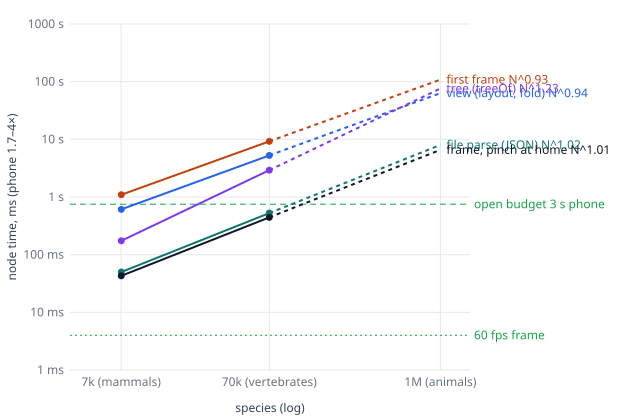

# The scale yardstick: a synthetic tree at any size, and what opening and moving it costs (ToLaD#343)

Ita asked (2026-10-14): "are we doing things right this time around? like would it scale? coz the next level is quite a bunch more animals". On 2026-11-16 he asked what is left before the amniotes (the mammals plus the birds and the reptiles, about **31,000 species**, 4.5 times the mammals), and the yardstick was rerun on that day's main (658e6a9), on the tree on its side as the page draws it.

**Short answer: not yet. The amniotes open and move, but about 10 times too slowly to open and 15 to 60 times too slowly to move.**
- **Open:** about 7.7 s of node time from the file in hand to the first frame, and **about 25 s on the phone proxy** (4× throttled CPU). The budget is 3 s, so it is about **9–10× over**, before the download.
- **Moving:** a frame costs **60–250 ms in node** (median, by gesture and depth), so **about 0.25–1 s on a phone**, 1 to 4 pictures a second. The budget is 16.7 ms (60 fps), so it is **15–60× over**. The worst frames of a pinch take 1–1.4 s in node.
- **Why:** the same reason as in October. Almost every step, at the open and on every frame, walks every species or every merged clade. The per-frame cost grows with the size of the tree (exponent 0.65–1.1 from 7k to 31k), not with what is on screen.
- **What must change before the amniotes:** the frame has to stop walking the tree: the merged clades drawn as precomputed ribbons from the cut walk, and the layout's rooms answered for the screen's x range only (`scalable-tree.md` §5, #340). The first frame has to do the same, and the file has to lose what the open does not need. The subtree tiles can wait for 70k and beyond. Details in **Amniotes (31k)** below.

## Amniotes (31k)
### Does it open and move acceptably on a phone?
No.

| | budget on the phone | 31k on the phone proxy | 31k in node | over by |
|---|---|---|---|---|
| open, the file in hand to the first frame | 3 s (all of it) | 25.1 s | 7.7 s | **~9×** (10× in node against the 0.75 s that the 3 s allows there) |
| the page before the data (HTML, script) | (in the 3 s) | 0.6 s | — | — |
| the download | (in the 3 s) | not measured: the synthetic tree is made in the page | — | ~6 MB gzipped for the synthetic file; **~13 MB** for a real one with the pictures' records (the mammals' rate), about 5 s at 20 Mbit/s |
| a frame (pinch, pan, flight; median) | 16.7 ms | not measured; ~0.25–1 s from node × 4 | 60–250 ms | **15–60×** |
| a frame, worst of a pinch | 16.7 ms | — | 1.0–1.4 s | 60–85× |
| memory | ~0.5–1 GB a tab | 1.2 GB (the whole browser, at the open) | 2.8 GB rss (after the gestures) | ~1.5–3× |

The phone proxy is node × 3.3 for the open today (25.1 s against 7.7 s at 31k); October measured × 4 for the draw, which the frame line uses.

### Which steps dominate (CPU profiles at 31k, node)
**The open** (10 s profiled, from the file read to the second frame):
1. **The first frame, 4.9 s.** It is the first frame that computes everything the later frames reuse: the gap labels and pictures (`labelsNow`, `gapCoverAt`, `gapPicsOf`, `picRanges`, `place`: 2.1 s), the merged clades' ribbons (`drawMerged`, its per-row `row` and `push`, `greenShareAt`: 2.2 s) and the walk that finds the level shown (`levelNow`, `levelFrom`, `landOf`, `openCamera`: 1.9 s; these overlap).
2. **The view, 2.1 s:** the layout (`layoutFan`, 0.9 s), the steady layout's typed arrays (`Steady`, `widthSums`, 0.8 s) and the fold (0.8 s).
3. **Garbage collection, 15%** of the open; the clade (0.3 s) and the unpack (0.3 s) are small.

**The frames** (150 s profiled: pinch, pan and a flight in and back, at home, in the largest order and in its largest family):
1. **The merged clades' ribbons, 43%.** `drawMerged` walks every merged clade on screen row by row (`row` 36%, `push` 18%), asking `lod.ts` `greenShareAt` for each row's green share (13%). This is the CPU rebuilding, every frame, geometry that does not change with the camera.
2. **The steady layout's rooms, 26%.** `Steady.extent` (18%, the largest single function) and `follow` (8%): each frame works out every row's rooms again, through `xTable`/`xRange` (8%).
3. **Labels, 15%:** `labelsNow` (9%) and the gap labels' cover (`gapCoverAt`, 7%), each walking all the items, not the shown ones.

Garbage collection takes another 16%, most of it the per-frame arrays of 1 and 2.

### What must change before the amniotes, sized against `scalable-tree.md` §5
| change (§5) | what it removes at 31k | must for 31k? |
|---|---|---|
| **The merged clades as precomputed ribbons, drawn as static world-space buffers with the camera as a uniform** (§5 "LOD as range draws", "static world-space buffers"; #340, `?gl=cols`, not on main yet) | `drawMerged` and `greenShareAt`: 43% of every frame and 2.2 s of the first | **must** |
| **The cut walk: per-frame work bounded by what is on screen** (the rooms answered for the screen's x range by prefix sums over leaf order, not every row's `extent`; labels from one cut) | `extent`, `follow`, `xTable` and the labels' walks: about 40% of every frame, and the labels' and level's 4 s of the first | **must** |
| **The first frame built from the cut, not from the whole tree** (the same two changes, applied to the open) | most of the 4.9 s first frame | **must** (with the two above) |
| **The file split: what the open needs, and the rest on demand** (histories, genealogies and pictures' records as sidecars; §5 "compact binary data") | the ~13 MB gzipped download and some of the 0.9 s parse and unpack on the phone | **must** for a 3 s open on a phone's network; a cheap version (sidecars by kind, or by order) is enough at 31k |
| decode in a worker, binary columns | the parse and unpack (0.9 s on the phone) off the main thread | should; not a must at 31k |
| **subtree tiles** fetched as a clade opens | the whole tree in memory and in one file | **can wait**: needed by ~70–100k (memory, a 46 MB file at 70k) and unavoidable by ~450k (V8's string limit) |
| anchor-relative coordinates | float32 precision past ~10⁶ zoom | can wait for 1M |

Sizing: the two frame changes have to take a frame from 60–250 ms to 4 ms in node, so they cannot be a speed-up of today's per-row code: they have to make the frame independent of the number of species, as §5 says. If they do, the first frame drops with them, and the open is left with the view's 2.1 s (which the build can do ahead, as it already does the seed), the clade and the parse: about 3 s in node, still about 4× over. So the layout's per-species work at the open (`layoutFan`, `Steady`, the fold) has to move to the build or a worker too.

## Today's numbers beside October's
Node, ms. October: main of 2026-10-15. Today: main of 2026-11-16 (658e6a9), the tree on its side. "Mammals" is the real `mammals.json` as the build wrote it (7,066 species drawn); the synthetic trees have 7,051, 31,225 and 70,509 living species.

**The open** (node):

| step | mammals Oct | mammals now | 7k Oct | 7k now | 31k now | 70k Oct | 70k now |
|---|---|---|---|---|---|---|---|
| file (JSON) | 9.4 MB | 9.3 MB | 8.1 MB | 4.8 MB | 20.8 MB | 81 MB | 46.0 MB |
| parse | — | 31 | 50 | 19 | 75 | 526 | 204 |
| unpack (columns, new) | — | 99 | — | 49 | 265 | — | 485 |
| tree | 178 | 6 | 174 | 5 | 38 | 2,900 | 48 |
| clade | — | 97 | 22 | 65 | 289 | 186 | 544 |
| view (layout, fold) | 747 | 1,103 | 611 | 467 | 2,129 | 5,300 | 5,157 |
| first frame | 781 | 1,389 | 1,095 | 1,282 | 4,903 | 9,200 | 14,369 |
| **open, parse to first frame** | ~1.7 s | **2.7 s** | **2.0 s** | **1.9 s** | **7.7 s** | **18.1 s** | **20.8 s** |
| second frame | — | 71 | — | 70 | 181 | — | 336 |
| the build's part (seed; now also genealogies and the packed tree) | 2.8 s | — | 2.9 s | 4.1 s | 18.7 s | 31 s | 49.8 s |
| memory (node rss, peak) | — | 0.85 GB | 1.0 GB | 1.4 GB | 2.8 GB | 6.1 GB (with gestures) | 3.6 GB (open only) |

Growth from 7k to 31k today (t ~ N^b): parse b 0.9, unpack 1.1, clade 1.0, view 1.0, first frame 0.9, the open 0.95. From 31k to 70k the first frame grows faster (b 1.3).

**The frames** (node, ms, median and p95 in brackets; 40 pinch steps, 30 pan steps, a flight to a species and back):

| depth, gesture | mammals now | 7k Oct | 7k now | 31k now |
|---|---|---|---|---|
| home, pinch | 31 (298) | 49 (156) | 30 (247) | 78 (1,443) |
| home, pan | 20 (28) | 12 (70) | 20 (31) | 60 (109) |
| home, flight | 52 (135) | 42 (90) | 30 (47) | 111 (235) |
| largest order, pinch | 38 (274) | 40 (72) | 71 (245) | 246 (1,026) |
| largest order, pan | 21 (31) | 34 (58) | 57 (71) | 202 (241) |
| largest order, flight | 39 (58) | — | 44 (148) | 204 (444) |
| its largest family, pinch | 67 (277) | 42 (109) | 22 (55) | 118 (283) |
| its largest family, pan | 37 (53) | 50 (83) | 12 (43) | 176 (336) |
| its largest family, flight | 36 (52) | — | 41 (101) | 138 (319) |

October's 70k frames were 440–770 ms (wall-time means). 70k frames were not rerun today (the brief asked for its open only).

**The phone proxy, the open** (headless Chromium, SwiftShader, 390×844, CPU 4× throttled; ms between the page's stamps). The machine was fairly quiet: load average 1.7 at the start, 5.1 at the end (October's runs were at 8–14).

| step | mammals | 7k | 31k |
|---|---|---|---|
| page start to the data (HTML, script, modules) | 0.6 s | 0.6 s | 0.6 s |
| parse (`json`; the mammals' includes reading the 9.3 MB body) | 970 | 38 | 197 |
| unpack | 269 | 175 | 688 |
| the note's frame, tree and clade (`unpack`→`clade`) | 447 | 390 | 1,135 |
| layout (`gl`→`layout`) | 1,587 | 434 | 2,857 |
| fold | 914 | 737 | 3,158 |
| rest of the view | 254 | 345 | 1,207 |
| first frame | 3,077 | 3,451 | 15,819 |
| **file in hand to first frame** | **7.6 s** | **5.6 s** | **25.1 s** |
| second frame | 1,407 | 1,370 | 1,571 |

The synthetic trees are made in the page (`tl:synth-gen`, `tl:synth-seed`, `tl:synth-file`: 15 s at 7k, 66 s at 31k on the proxy), which is the build's work, left out above. October's quieter 7k phone open was 3.3 s with `?labels=cut&frame=cut`, 12.9 s with the default labels on a busy machine.

### What changed since October
- **The tree comes built.** The build now writes the dated tree packed, every strand's genealogy and the layout seed into the file, and packs the species in columns (#255). The tree step fell from 2.9 s to 48 ms at 70k, and the file shrank 43% (81 → 46 MB at 70k). The build's part grew instead: 50 s at 70k, 19 s at 31k.
- **The first frame got heavier.** The tree on its side, the gap labels and titles and the level walk cost more on the first frame: the mammals' first frame went from 0.78 s to 1.39 s, and 70k's from 9.2 s to 14.4 s. So the open at 70k is no faster (18.1 → 20.8 s) despite the tree.
- **The frames are where they were.** At 7k they are 20–70 ms median, as in October. They still grow with the tree.
- **#340 (`?gl=cols`) has not landed**, so the world-space columns were not measured. `?labels=cut` is on main, but the node switches October used for it (`TOLAD_LABELS`, `TOLAD_FRAME`) are gone, so the `cut` mode was not rerun.

### How it hooks into the page today
The level stepper is gone (#418), so `?level=synthetic` is no longer a level. The one hook is in `FanApp.tsx`: `loadMammals(synthLoader())`. `synthLoader` (`synthetic-level.ts`) returns the synthetic tree's maker only when the URL says `?level=synthetic`; otherwise it returns nothing and the page fetches `mammals.json` as before. The synthetic data is made as today's build makes `mammals.json`: the seed, the genealogies and the packed tree, through JSON once, packed in columns, then read back with the page's own `unpackMammals`. `view.ts` is not touched. In node, `scaleperf.test.ts` turns the sideways tree on (`setFlip`), because node has no URL and would otherwise draw the old upright tree.

**To run it:**
- Node, one size: `cd web && SCALEPERF=out.json SCALE_N=31000 npx vitest run src/fan/scaleperf.test.ts` (about 3 min at 31k, 3.2 GB). `SCALE_N=mammals` reads the built `dist-single/mammals.json` instead. `SCALE_GESTURES=0`: the open only (70k: 80 s, 3.8 GB). `SCALE_PROF=f.cpuprofile`: a CPU profile. `SCALE_CAP_MIN=20`: each depth's gestures stop after that many minutes and the output says where (`cut`); none needed it today. `SCALE_FLIP=0`: the old upright tree.
- Phone proxy, the open: `cd web && npm run build:single && LOADONLY=1 SYNTH_N=31000 ONLY=s31000-home LOAD_TIMEOUT=300000 flock /tmp/tolad-browser.lock node scripts/phoneperf.mjs`.
- Both, every size: `flock /tmp/tolad-browser.lock node scripts/scale.mjs` (`NS=7000,31000` by default).
- In the page: `?level=synthetic&n=31000`.

## October's run (2026-10-15)
What follows is the October note as written, on the code of that day. Its numbers are stale where the tables above give today's; its yardstick, its budgets and its sizing of the tiles still stand.

The October short answer: the mammals were the largest tree the code could open. 70k opened in about 18 s of node time and every frame cost about 0.45–0.8 s; 1M could not even parse its data file (about 1.15 GB of JSON, past V8's 512 MB string limit).

### The yardstick

`web/src/fan/synthetic.ts` generates a tree of any size, with the same data shape as `mammals.json`: a dated tree, living and fossil species, population histories, mass, generation length, Red List, natural baselines and names. It is deterministic for a given seed and size. Each rule is a standard model, with its parameters read off `data/mammals`:

| | rule | 7k synthetic | mammals |
|---|---|---|---|
| topology, dates | birth–death reconstructed tree as a coalescent point process (Lambert & Stadler 2013), μ/λ 0.8, root 195 Ma | split ages q25/50/75 1.5 / 4.3 / 10.9 Ma | 1.4 / 3.4 / 7.5 Ma |
| splits, polytomies | splits < 0.1 Myr apart merged | 6,856 splits, 198 polytomies | 6,273, 348 |
| fossils | 51 per 7,015 living, grafted on random edges | 51 | 51 |
| mass | Brownian motion of log mass down the tree | log10 g q5–q95 −0.3…2.9 | 0.8…4.6 |
| population | Damuth's law plus log-normal scatter | alive log10 median 6.0 | 5.9 |
| histories | 10.6% of the living, curated-style segments | 742 | 746 |
| names | temporal banding: order < 66 Ma, family < 33 Ma, genus < 18 Ma | 1,176 named splits | 689 |
| JSON | the same `MammalData` shape | 8.1 MB | 9.4 MB |

The synthetic tree is more balanced than a real one (depth 27 vs 40), because a coalescent point process gives a Yule-shaped topology.

**Sanity check: the 7k tree times like the mammals.** These are node times for the same steps (`loadperf` with the seed):

| | tree | view | first frame | the build's seed |
|---|---|---|---|---|
| mammals | 178 ms | 747 ms | 781 ms | 2,775 ms |
| synthetic 7k | 174 ms | 611 ms | 1,095 ms | 2,906 ms |

#### How to run it
All of this runs on demand only, by hand, for speed work. None of it is in the suite. The suite carries only `synthetic.test.ts`, a 600-species check that takes well under a second.

- **Everything:** `cd web && npm run build:single && flock /tmp/tolad-browser.lock node scripts/scale.mjs`
  - It runs node, then the phone proxy, at 7k and 70k, with the default labels and with `?labels=cut&frame=cut`.
  - It writes `scale-out/*.json` and prints the fitted exponents.
- **Options:** `NS=`, `MODES=default,cut,noorders`, `NODE=0`, `PHONE=0`.
- **Node only, one size:** `SCALEPERF=out.json SCALE_N=70000 npx vitest run src/fan/scaleperf.test.ts`
  - `SCALE_GESTURES=0` measures the load only.
  - `SCALE_PROF=f.cpuprofile` records a CPU profile.
- **In the page:** `?level=synthetic&n=70000`. It is off the level stepper.
  - `&labels=cut&frame=cut` turns on the cut labels and framing.
  - `&orders=0`, `&seed=0` and `&json=0` are the switches below.
  - The page stamps `tl:synth-gen`, `tl:synth-seed` and `tl:synth-file` for the build's part. From `tl:fetch` on, the stamps are the mammals' own.

**How long a run takes on this machine:**

| run | time | peak memory |
|---|---|---|
| node, 7k | ~1 min | ~1 GB |
| node, 70k, load only | ~1 min | — |
| node, 70k, with gestures | over 2 h (the flight in the family depth had not ended after 2 h: its frames take seconds each) | 6.1 GB |
| phone proxy, 7k | ~1 min a load, ~2 min with gestures | — |

At 70k the gestures run slowly because each frame takes most of a second, and a flight in and back is about 300 frames. The 1M tree is not run: it does not fit, as explained below.

### What the tree has to be told: its orders
The first finding came before any timing. **A tree is drawn with level of detail only if its orders are in a hand list.**
- The fold's level above the orders and the merged clades (`lod.ts`) both work from `splits.ts` `ORDER_TAXA`, the 25 mammal order names.
- The 7k synthetic tree has no orders in that list. With nothing merged, it opened with a 12 s first frame and frames of about 0.6 s, against 1.1 s and 0.04 s once its orders were registered.
- The same is true of any real vertebrate or animal tree today: none of its orders are in the list.

The synthetic level registers its own orders (the splits founded under 66 Ma) so that it measures the mammals' design at scale. `?orders=0` measures it without them. The fix is in the plan already: the cut walk of `research/scalable-tree.md` §5, step 5, has to choose what is merged from the tree's own structure, not from a list of names.

### The numbers (node; the phone proxy is 1.7–4× slower, see below)

The exponent b is the fit of t ∝ N^b between 7k and 70k.

| step | 7k | 70k | b | 1M (extrapolated) |
|---|---|---|---|---|
| **build** (vite.config.ts today): generate | 92 ms | 436 ms | 0.7 | — |
| **build**: the layout seed | 2.9 s | 31 s | 1.03 | ~8 min |
| file size (JSON) | 8.1 MB | 81 MB | 1.00 | **~1.15 GB: over V8's 512 MB string limit, cannot be parsed** |
| parse (`r.json()`) | 50 ms | 526 ms | 1.02 | (cannot) |
| tree (`treeOf` + `nameOrders`) | 174 ms | 2.9 s | **1.22** | ~75 s |
| clade (`cladeOf`) | 22 ms | 186 ms | 0.93 | ~2.5 s |
| view (`new FanView`: layout, fold) | 611 ms | 5.3 s | 0.93 | ~65 s |
| first frame | 1.1 s | 9.2 s | 0.93 | ~110 s |
| **open, parse to first frame** | **2.0 s** | **18.1 s** | 0.97 | **~4–5 min** |
| frame, pinch and pan at home | 43 ms | 440 ms | 1.0 | ~6 s |
| frame, pinch and pan in the largest order | ~40 ms | ~500 ms | 1.1 | ~10 s |
| frame, pinch and pan in its largest family | ~46 ms | ~770 ms | 1.2 | ~20 s |
| flight in and back, per frame | 35–42 ms p50 | ~0.7 s | ~1.2 | — |
| memory (node rss) | 1.0 GB | 6.1 GB | 0.8 | **~50 GB** |

How the 70k frame times were read: they are the gesture's wall time divided by its 70 frames, from the run's log. The 70k run's per-frame JSON was not finished when this was written, so the p50/p95 figures are only for 7k. At 7k:
- home: pinch p50/p95 49/156 ms, pan 12/70, flight 42/90;
- the largest order: pinch 40/72, pan 34/58;
- its family: pinch 42/109, pan 50/83.

`?labels=cut&frame=cut` at 7k costs about the same: home pinch p50 48, pan 12, flight 36. Its first frame is 1.6 s against 1.1 s.

**Phone proxy at 7k** (4× throttle). The machine was busy with the 70k node run (6 GB) and other sessions, at load average 8–14, so the two loads below differ by 3× for the same steps. Read the quieter one. The steps are timed by the page's stamps from `tl:fetch`, with the build's generation and seed before it left out:

| step | busy run (default labels) | quieter run (`?labels=cut&frame=cut`) |
|---|---|---|
| parse | 0.3 s | 0.08 s |
| tree | 0.5 s | 0.12 s |
| clade | 2.3 s | 0.55 s |
| gl + layout | 3.5 s | 0.8 s |
| fold | 1.4 s | 0.43 s |
| view | 1.4 s | 0.28 s |
| first frame | 3.6 s | 1.06 s |
| **parse to first frame** | **12.9 s** | **3.3 s** |
| labels frame | +19.8 s | +6.0 s |
| HTML + script before it | 3.0 s | 1.0 s |

The phone frame deltas from these runs (rAF p50 of 0.2–2.6 s) are mostly contention, so they are not quoted. The draw's own time is steadier. Its p50 is 185–415 ms on the phone proxy against 40–50 ms in node, the expected ~4×. So a 7k frame is already about 12× over a phone's 16.7 ms, and the 70k frame about 110×.

The phone 70k run was not made: it needs about 6 GB, and the worker's memory lease is 2 GB.

#### Which steps break first, and where
1. **The data file, at about 400k species.** JSON grows exactly linearly (1.15 KB per species, 38% of it histories). It crosses V8's 512 MB string limit (`MAX_STRING_LENGTH` 536,870,888) at about 450k species. Past that, `r.json()` cannot run at all, which is why 1M never opens. Long before that, 81 MB at 70k is too much to fetch on a phone.
2. **Memory, between 70k and 1M.** At 70k it is about 87 KB per species. The species records, genealogies, the Steady layout's typed arrays and the twig caches all scale with N. A phone tab has roughly 0.5–1 GB, which today is reached at about 10k species.
3. **Every frame is O(N).** The node profile at 7k, over 60 s of gestures, puts the time here:
   - Steady's per-row layout: `row`, `left`, `extent`, `centreSums`, `compute`, `follow` (~27 s).
   - The strands of species not merged: `drawStrand`, `lanePoints`, twigs (~21 s).
   - The merged clades' greens: `drawMerged`, `Lod.greenAt` (~15 s).
   - `xRange`/`xTable` (~10 s).
   - Labels (~8 s).

   Each of these walks every node or every species on each frame. That is the opposite of the property in `scalable-tree.md` §5: "every per-frame term bounded by what is on screen".
4. **`treeOf` is superlinear** (b ≈ 1.2): it is the only load step that grows faster than N. Everything else at load is linear, but at about 0.26 ms of node time per species (about 1 ms on a phone), which alone puts 70k over a minute.

### Budgets: opening 70k in ≤ 3 s and pinching at 60 fps on the phone proxy
How much slower the phone proxy is than node was measured here at 7k: about 1.7× for the load steps (3.3 s against 2.0 s in the quieter run) and about 4× for the draw. The budgets use 4×, the conservative figure. So 3 s on the phone is about 750 ms in node, and a 16.7 ms frame is about 4 ms in node.

| step | budget on the phone | node | today at 70k (node) | factor to cut |
|---|---|---|---|---|
| HTML + script | 0.8 s | 200 ms | ~250 ms (the mammals') | 1 |
| fetch the first tile | 0.4 s | — | 81 MB JSON | the bytes ÷ 40 |
| decode it (in a worker, typed arrays) | 0.3 s | 75 ms | 526 ms | 7 |
| tree + clade from it | 0.3 s | 75 ms | 3.1 s | 40 |
| view: layout and fold (seeded) | 0.5 s | 125 ms | 5.3 s | 40 |
| first frame | 0.4 s | 100 ms | 9.2 s | 90 |
| labels frame | 0.3 s | 75 ms | — | — |
| **open** | **3.0 s** | **750 ms** | **18.1 s** | **24** |
| a frame (pinch, pan, flight) | 16.7 ms | 4 ms | 440–770 ms | **110–190** |
| memory | ~500 MB | — | 6.1 GB | 12 |

None of these factors comes from shaving a step. A 24× cut at load and a 100× or larger cut per frame mean that the work has to stop being per species and start being per visible node. That is §5's design, and these numbers size it.

### What loading in pieces has to look like
The cost per species measured at 7k and 70k gives:
- **Load:** ~0.26 ms of node time per species materialized, about 1 ms on a phone.
- **Per frame:** ~6 µs of node time per species in the tree.

To fit the budgets above:
1. **What the page opens with is at most ~1–2k materialized entities, whatever N is.** At today's per-species cost, a 3 s open allows about 1,500 species-equivalents. The top tile is therefore the cut at home, not the species:
   - the orders and families as **aggregate ribbons**: the merged green per row and the outline, precomputed at build time per clade;
   - the territories (`cut.ts`) and the names of those few hundred nodes.

   At 70k, home shows about 540 orders (the 66 Ma band). At 7k it shows 62, where the mammals have 25. That is inside the limit, but only about 3× inside it: at 1M a level above the orders has to be merged too, which the cut walk, being recursive, does.
2. **Subtree tiles of about 2–5k species**, fetched when a clade opens past `MERGE_PX`:
   - Each tile is binary and columnar: per species about 40 B of numbers and about 20 B of name, so about 300 KB for 5k species before brotli.
   - Each opens in under ~100 ms on a phone, if its per-species work is done at build time: the genealogies (load255h's largest single cost), the seed layout and the merged greens.
   - `web/src/data/tile-source.ts` and `worker.ts` from the first engine already do the fetch side of this.
3. **Histories and genealogies are their own sidecar per tile.** They are 38% of the bytes and most of the per-species work at load, and are needed only when a species is near the screen.
4. **Per-frame work is O(visible).** The rooms per row (Steady), the merged greens, `xTable` and the strands each need an index that answers for an x range without visiting the rest:
   - world-space static buffers plus range draws (§5, steps 4–5);
   - prefix sums over leaf order for the greens, as load255h proposed.

   The yardstick target is a frame at 70k costing what the 7k frame costs now (40 ms node) or less, and then 4 ms.
5. **At 1M, only the loaded tiles exist.** Nothing whose size is O(N) can live on the main thread: no whole-tree JSON, no whole-tree layout and no whole-tree typed arrays. The build makes the tiles and the top cut.

### What was not done
- **No 1M run.** At 1M the generator alone would need several GB of memory, more than the lease, and the page cannot parse its file. The 1M column is extrapolated from the 7k–70k fits.
- **No phone run at 70k.** It needs about 6 GB, more than the lease.
- **The 70k per-frame p50/p95 figures** were still being written when this was written. The 70k frame figures above are wall-time means.
- **`?gl=cols`** had not landed, so it was not measured.
